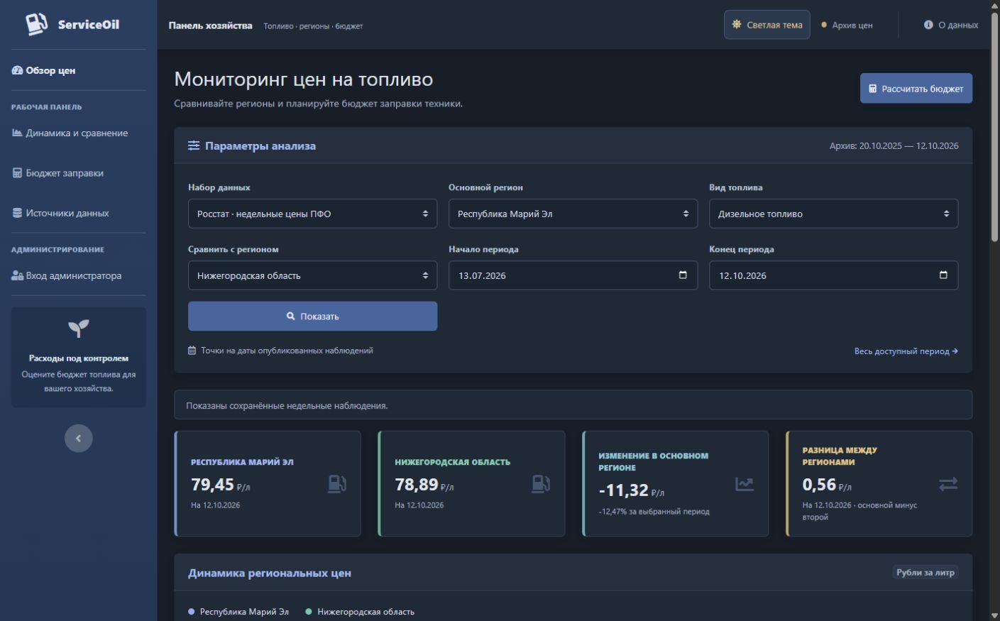
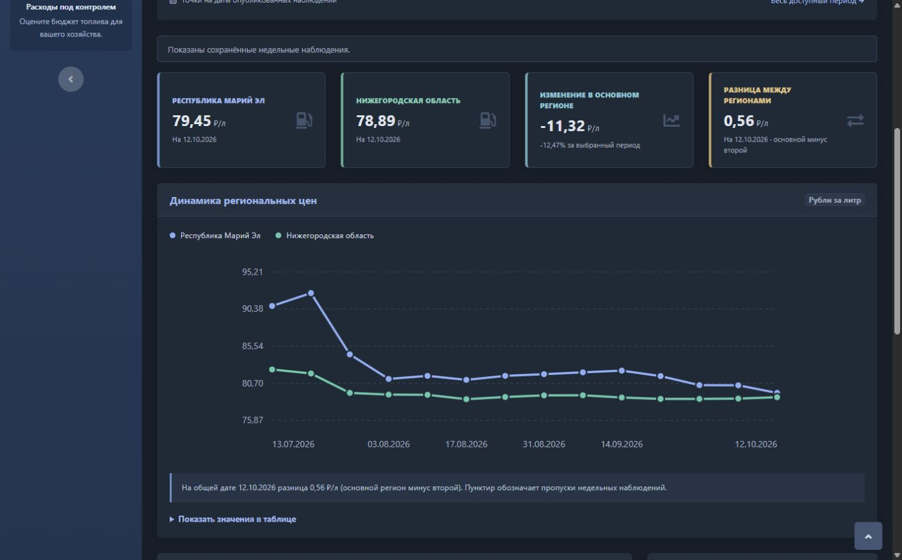
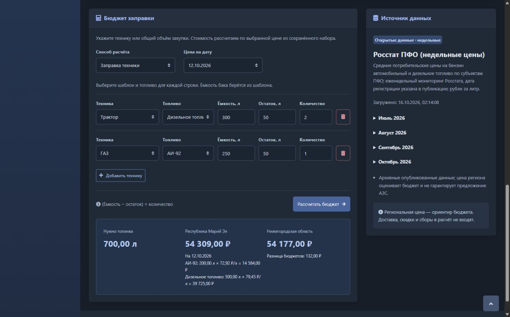

# ServiceOil


[](LICENSE)

**Региональные цены на топливо и расчёт бюджета заправки сельхозтехники.**

ServiceOil помогает сравнивать цены на дизельное топливо и АИ-92 между регионами, отслеживать их изменение и оценивать расходы на заправку. Источник данных — недельные публикации Росстата по субъектам Приволжского федерального округа. Доступные регионы и даты определяются загруженными наблюдениями.

## Содержание

- [Возможности](#возможности)
- [Скриншоты](#скриншоты)
- [Стек](#стек)
- [Установка и запуск](#установка-и-запуск)
- [Настройки](#настройки)
- [API](#api)
- [Документация](#документация)
- [Автор](#автор)
- [Лицензия](#лицензия)

## Возможности

- История цен, последняя доступная цена и изменение за выбранный период.
- Сравнение двух регионов на общих датах наблюдений.
- Автоматическое обновление графика при смене региона, топлива или региона сравнения.
- Последний месяц по умолчанию: начало округляется до ближайшего понедельника. Можно выбрать даты вручную или открыть весь доступный период.
- Ссылки на исходные публикации, сгруппированные по месяцам и свёрнутые по умолчанию.
- Расчёт бюджета по объёму закупки или списку техники.
- Шаблоны техники из БД: ёмкость бака заполняется из шаблона, топливо выбирается отдельно для каждой строки.
- Общий бюджет смешанного парка с разбивкой по видам топлива и сравнением стоимости между регионами.
- Панель администратора для импорта цен и создания шаблонов техники.
- Смена логина и пароля администратора с подтверждением текущего пароля и завершением всех сессий.
- Светлая и тёмная темы, адаптивный интерфейс.

Региональная цена — ориентир для бюджета, а не предложение конкретной АЗС. Доставка, скидки и прогноз будущих цен в расчёт не входят. На графике показаны фактические наблюдения; пунктир соединяет точки через пропуски недельных данных.

## Скриншоты

### Мониторинг цен

Выбор региона, топлива и периода, сводка цен и сравнение с другим регионом.



### Сравнение регионов

Динамика цен на дизельное топливо в Республике Марий Эл и Нижегородской области за выбранный период.



### Бюджет заправки

Расчёт смешанного парка: шаблоны техники, отдельный выбор топлива и итоговая стоимость по двум регионам.



## Стек

| Часть проекта | Технологии |
| --- | --- |
| Сервер | Java 21, Spring Boot 4.1.1, Spring Web MVC |
| Данные | PostgreSQL 18, Spring Data JPA / Hibernate, Flyway |
| Вход и валидация | Spring Security, Jakarta Validation |
| Интерфейс | HTML, CSS, JavaScript, SVG, Bootstrap 4.6, SB Admin 2 |
| Сборка и запуск | Maven, Lombok, Docker, Docker Compose |
| Инструменты тестирования | JUnit, Mockito, H2, Postman CLI |

Ресурсы интерфейса поставляются локально: для его отображения не требуется CDN. Импорт публикаций и открытие ссылок Росстата требуют доступа к интернету.

## Установка и запуск

Нужны Docker Desktop в режиме Linux-контейнеров и Docker Compose v2. Устанавливать Java, Maven или PostgreSQL на компьютер для контейнерного запуска не требуется.

Из корня проекта выполните:

```powershell
docker compose up -d --build --wait
```

Compose соберёт приложение, запустит PostgreSQL и применит миграции БД.

| Страница | Адрес по умолчанию |
| --- | --- |
| Мониторинг цен и калькулятор | [http://localhost:8080](http://localhost:8080) |
| Вход администратора | [http://localhost:8080/login](http://localhost:8080/login) |
| Панель администратора | [http://localhost:8080/admin](http://localhost:8080/admin) |

Если в окружении или `.env` задан `SERVICEOIL_PORT`, используйте этот порт вместо `8080`.

### Первый запуск

1. Откройте страницу входа. Первоначальные логин и пароль: `admin` / `admin`.
   В боковом меню панели доступен пункт **«Логин и пароль»**: после сохранения изменений нужно войти заново.
2. В панели администратора выберите **«Ручной импорт»**, задайте период наблюдений и дождитесь завершения загрузки.
3. В блоке **«Бюджет заправки»** нажмите **«Добавить шаблон техники»** рядом с **«Добавить технику»**. Укажите название, ёмкость бака и топливо по умолчанию.
4. На главной странице выберите регион и период. Для расчёта заправки добавьте технику из списка шаблонов, укажите топливо, остаток в баке и количество машин.

При создании новой БД цены и шаблоны техники отсутствуют. Цены появляются после импорта, шаблоны — после добавления администратором. Созданные данные сохраняются между перезапусками.

Для техники объём заправки рассчитывается как `(ёмкость бака − остаток) × количество`. Сервер берёт ёмкость из сохранённого шаблона, а цену — из БД на выбранную дату. Для смешанного парка доступны даты, на которые есть цены всех необходимых видов топлива в выбранных регионах.

### Обновление и остановка

После изменения приложения пересоберите его контейнер:

```powershell
docker compose up -d --build --no-deps --wait app
```

Остановить приложение и базу данных:

```powershell
docker compose down
```

Данные PostgreSQL хранятся в томе `serviceoil_pg`. Обычная остановка через `docker compose down` сохраняет их.

## Настройки

Параметры задаются переменными окружения или в локальном файле `.env` в корне проекта.

Для первого запуска скопируйте [шаблон настроек](.env.example) и при необходимости измените значения:

```powershell
Copy-Item .env.example .env
```

Если `.env` уже существует, редактируйте его напрямую. Локальный `.env` исключён из Git; `.env.example` содержит только пример настроек.

| Переменная | По умолчанию | Назначение |
| --- | --- | --- |
| `SERVICEOIL_PORT` | `8080` | Порт сайта на компьютере |
| `SERVICEOIL_DB_PASSWORD` | `serviceoil_local` | Пароль PostgreSQL для приложения и БД |
| `ROSSTAT_WEEKLY_INDEX_URL` | `https://rosstat.gov.ru/compendium/document/50798` | Индекс публикаций Росстата |
| `ROSSTAT_WEEKLY_SCHEDULE_ENABLED` | `false` | Включение автоматического импорта |
| `ROSSTAT_WEEKLY_CRON` | `0 0 10 * * THU` | Расписание: четверг, 10:00 |
| `ROSSTAT_WEEKLY_ZONE` | `Europe/Moscow` | Часовой пояс расписания |
| `ROSSTAT_WEEKLY_LOOKBACK_DAYS` | `14` | Окно поиска недавних публикаций |

Пример `.env` для запуска сайта на порту `8086` с автоматическим импортом:

```dotenv
SERVICEOIL_PORT=8086
ROSSTAT_WEEKLY_SCHEDULE_ENABLED=true
```

После изменения настроек повторите команду запуска Compose. Автоматический импорт по умолчанию выключен; ручной импорт доступен администратору независимо от расписания.

## API

Базовый путь — `/api/v1`. POST-запросы ниже принимают JSON с `Content-Type: application/json`.

| Метод | Путь | Назначение |
| --- | --- | --- |
| POST | `/catalog` | Регионы, топливо и доступные периоды |
| POST | `/prices/history` | История цен |
| POST | `/prices/summary` | Сводка и изменение цены |
| POST | `/prices/compare` | Сравнение двух регионов |
| POST | `/refueling/estimate` | Бюджет одного вида топлива по объёму или списку техники |
| POST | `/refueling/fleet-estimate` | Бюджет техники по шаблонам с разными видами топлива |
| GET | `/vehicle-templates` | Список сохранённых шаблонов техники |
| POST | `/admin/vehicle-templates` | Создание шаблона администратором |
| POST | `/admin/rosstat/import` | Импорт недельных цен администратором |
| GET | `/admin/session` | Состояние административной сессии и CSRF-токен |
| POST | `/admin/account` | Смена собственного логина и/или пароля с завершением сессий |

Пример тела запроса к `/api/v1/prices/history`:

```json
{
  "sourceId": "ROSSTAT_PFO_WEEKLY",
  "regionId": "12",
  "fuelCode": "DIESEL",
  "from": "2026-09-14",
  "to": "2026-10-12"
}
```

Коды топлива: `DIESEL` и `AI92`. Для `/catalog` достаточно тела `{}`. Период включает обе границы и ограничен 366 календарными днями; расчёт бюджета требует цены на точную дату.

Просмотр данных и расчёты доступны без входа. Административные изменения требуют сессии Spring Security и CSRF-токена. Вход выполняется через `/login`, выход — через `/logout`.

## Документация

Дополнительные материалы в локальной рабочей копии:

- [Спецификация проекта](docs/SPEC.md).
- [Импорт Росстата и эксплуатация](docs/ROSSTAT_OPERATIONS.md).
- [Источники данных](docs/DATA_SOURCES.md).
- [Контракт OpenAPI](postman/specs/serviceoil.openapi.yaml).

## Автор

[Ярослав · @Krastti](https://github.com/Krastti)

## Лицензия

Проект распространяется по [лицензии MIT](LICENSE). Сведения о сторонних ресурсах интерфейса и их лицензиях находятся в [THIRD_PARTY.md](src/main/resources/static/vendor/THIRD_PARTY.md).
